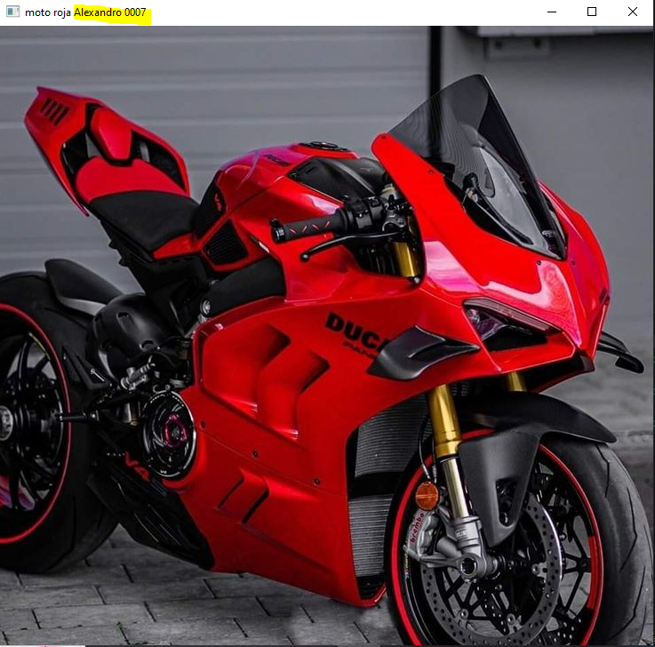
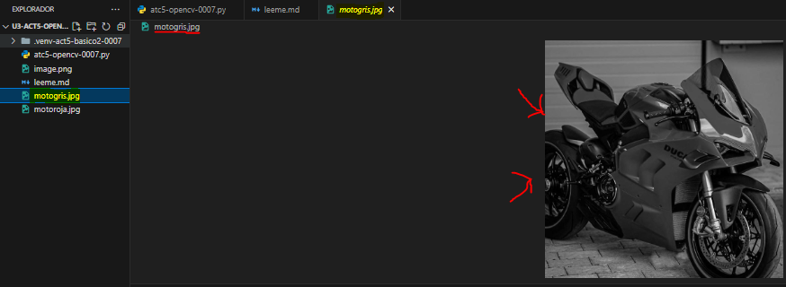
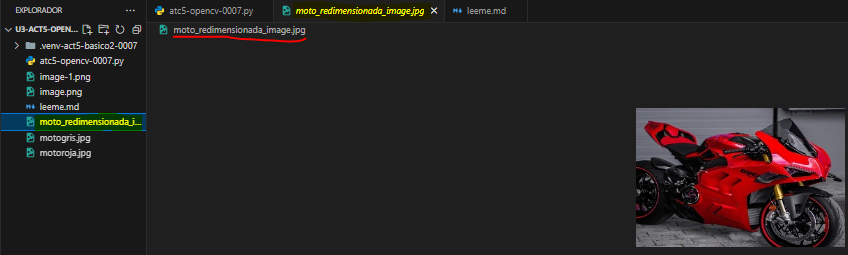
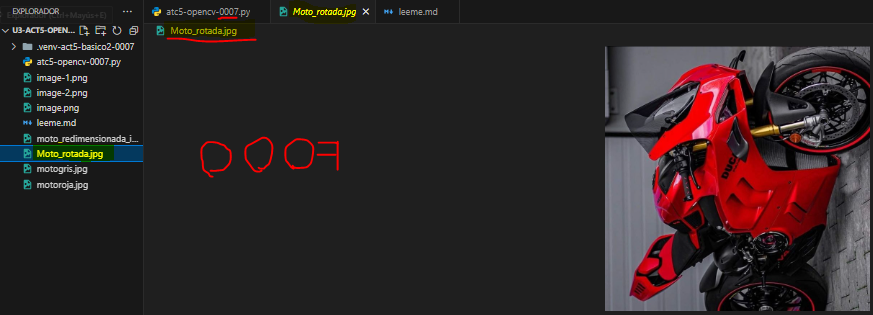
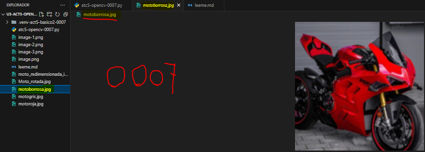
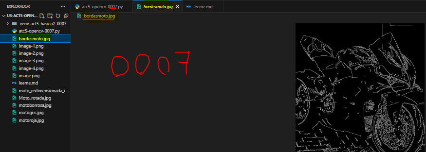
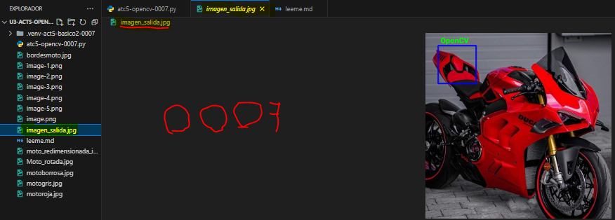
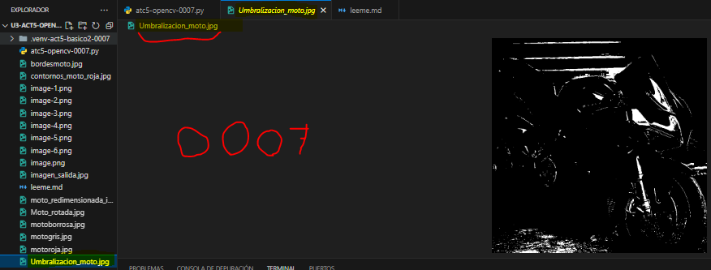
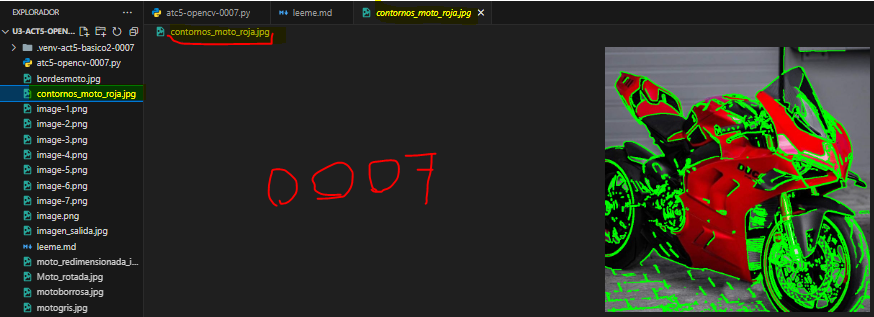

## Imagen original 

## Imagen a escala de grises

## Cambiando el tamaño de la imagen

## imagen rotada

## imagen borrosa

## delinear los bordes de la imagen en escala de grises

## rectangulo en la imagen 

## thresholding en la imagen

## mostrar los contornos en la imagen
